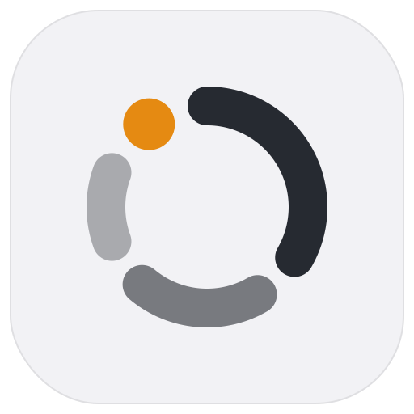

<p align="left">
  <a href="LICENSE"></a>
</p>

<p align="center">
  
</p>

<p align="center">
  <b>A menu bar time tracker for macOS</b>: declare what you are doing now, and look back later at
  where the time went.
</p>

> **avow** — to declare openly and publicly.

Picking a task in Avow is a declaration: *"This is what I'm doing right now."* The clock starts the
moment you choose, the menu bar keeps the elapsed time in view, and every entry is kept so you can
later see how many hours went into which kind of work.

> **Status: 1.0.** Avow is in daily use. Download the latest DMG from
> [Releases](https://github.com/h1d3mun3/Avow/releases), or build it from source.

## Why Avow

- **Starting is a declaration, not a timer.** Choose a task from the menu bar or from the quick
  panel (⌥⇧Space by default, from any app) and tracking starts. Choosing another task switches to
  it; there is nothing to set up or remember to start.
- **Built for looking back.** The Overview shows total, weekly, and daily time with a per-project
  breakdown, and the Calendar shows any day as a timeline of entries grouped by task. Facets label
  kinds of work across projects, and project groups bundle projects for combined reporting.
- **Records stay exact.** Start and end times are stored at full precision. Rounding to whole
  minutes is a display setting only, so turning it on or off never changes the data. Any entry can
  be edited or deleted afterwards.
- **Your data stays on your Mac, in files you can read.** Everything is stored locally, with no
  account and no sync. A JSON backup round-trips every project, task, entry, facet, and group, and
  restores by merging or replacing in a single transaction; a CSV export of all entries is there for
  spreadsheets.
- **Decisions are written down.** Avow does not color-code projects or facets, on purpose; the
  reasoning, and what would make it worth revisiting, is recorded in
  [`docs/decisions/`](docs/decisions/0001-no-color-coding.md).

## Using Avow

- **Menu bar.** The status item shows the arc alone while idle, and the arc with the "now" point
  and the elapsed time while tracking. Click it to pick a task, stop tracking, or open the
  Dashboard.
- **Quick panel.** The global shortcut opens a floating panel to search for a task and start it
  without leaving the app you are in. Change the shortcut in **Settings > Shortcuts**.
- **Dashboard.** Create projects and their tasks, reorder projects by dragging them in the sidebar,
  and archive finished ones to keep the sidebar tidy without losing their time.
- **Settings.** Round displayed durations to minutes, export and import JSON backups, export CSV
  reports, and reset all data.

## Building

Requirements:

- macOS 26.0 or later
- Xcode 26 or later

```sh
git clone https://github.com/h1d3mun3/Avow.git && cd Avow

# Build the app
xcodebuild build -scheme Avow -destination 'platform=macOS'

# Run the tests
xcodebuild test -scheme Avow -destination 'platform=macOS'
```

To build without a signing certificate, add `CODE_SIGNING_ALLOWED=NO` to the `xcodebuild` command.
Opening `Avow.xcodeproj` in Xcode and running it (⌘R) works too.

Two scripts support the app:

- `scripts/gen_avow_icon.py` regenerates the app icon (`Avow/Resources/Avow.icon`) and the menu bar
  images from the design values at the top of the file.
- `scripts/package-dmg.sh` packages a signed, notarized `Avow.app` into a distributable DMG.

## License

MIT. See [LICENSE](LICENSE).
